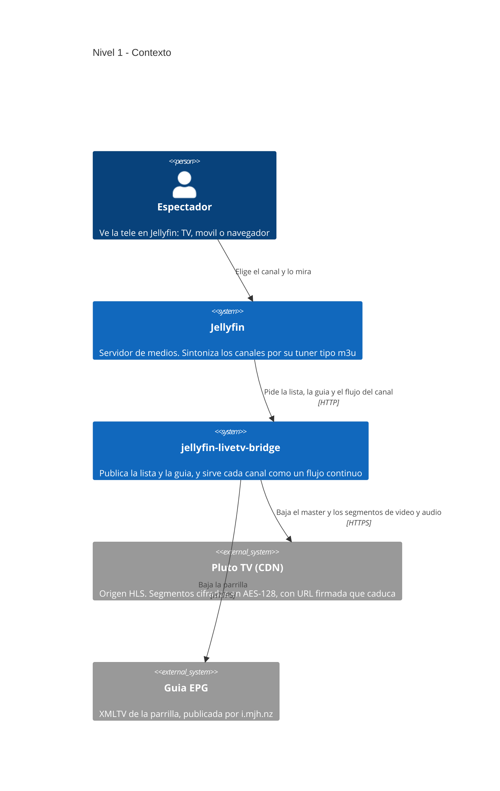

# jellyfin-livetv-bridge

Convierte listas M3U/HLS en un **tuner con guia para Jellyfin Live TV**, sin
antena. Corre en un contenedor Docker (Debian + Python 3.12) y no necesita
hardware de captura.

[](https://github.com/mxhectorvega/jellyfin-livetv-bridge/actions/workflows/tests.yml)
[](LICENSE)


## Indice

- [Arquitectura en una vista](#arquitectura-en-una-vista)
- [Que resuelve y que NO](#que-resuelve-y-que-no)
- [De dónde salen los canales](#de-dónde-salen-los-canales-el-repo-no-trae-ninguno)
- [Arranque rapido (Docker)](#arranque-rapido-docker)
- [Estructura](#estructura)
- [Pruebas](#pruebas)
- [Estándares que se comprueban](#estándares-que-se-comprueban)
- [Catalogos: varios alimentados, uno visible](#catalogos-varios-alimentados-uno-visible)
- [Conectar a Jellyfin Live TV (paso a paso)](#conectar-a-jellyfin-live-tv-paso-a-paso)
- [Rele HLS con colchon](#rele-hls-con-colchon-relayid)
- [Seguridad](#seguridad)
- [Configuracion](#configuracion)
- [Decisiones de diseno (y por que)](#decisiones-de-diseno-y-por-que)
- [Limitaciones conocidas](#limitaciones-conocidas)
- [Licencia](#licencia)

Documentacion de apoyo:

- [`docs/ARQUITECTURA.md`](docs/ARQUITECTURA.md) — los cuatro niveles del modelo
  C4, el flujo de un canal de punta a punta, y por que el sistema tiene esta
  forma y no otra.
- [`docs/CONFIGURACION.md`](docs/CONFIGURACION.md) — todas las variables y todos
  los campos de `sources.yml`, con su valor por defecto.
- [`CHANGELOG.md`](CHANGELOG.md) — que cambio y cuando.
- [`DISCLAIMER.md`](DISCLAIMER.md) — alcance y uso.

## Arquitectura en una vista

Quien usa el sistema y de quien depende. El resto, en
[`docs/ARQUITECTURA.md`](docs/ARQUITECTURA.md).



## Que resuelve y que NO

**Resuelve**, y es el motivo de que exista:

- **El corte a comerciales.** Los origenes HLS de estos proveedores terminan el
  flujo a media emision y Jellyfin lo lee como "el canal se acabo". El rele
  `/relay/<id>` lo tapa: baja los segmentos por su cuenta, los mantiene en un
  colchon y los sirve continuos.
- **La discontinuidad de la linea de tiempo.** Al saltar a una fuente alterna,
  `ts_splice.py` desplaza PCR, PTS y DTS para que el flujo siga con una sola
  linea de tiempo en vez de cortarse.
- **El audio que viene aparte.** Cuando el canal publica el audio en su propia
  playlist, `ts_mux.py` lo junta con el video en un solo MPEG-TS.
- **El cifrado AES-128** del HLS, que no es DRM y se descifra al vuelo.
- **La salud de los canales**, con backoff y reactivacion automatica.
- **El catalogo y la guia** de las listas que tu declares.

**NO resuelve**:

- **DRM de verdad** (CENC / SAMPLE-AES). Un canal con DRM se marca y se rechaza
  con 403; no se intenta romper.
- **El contenido en si.** El repo no trae ninguna lista de canales: tu declaras
  las fuentes. Ver "De donde salen los canales".
- **Grabar.** No guarda copia de nada; reemite lo que ya esta publicado.

## De dónde salen los canales (el repo NO trae ninguno)

**Este repositorio no incluye listas de streams ni canales.** Trae el motor:
lee listas M3U/HLS que tú aportas, las valida, las ordena, arma la guía y lo
sirve todo a Jellyfin como tuner + guía. Las fuentes son tuyas.

Por eso `config/sources.example.yml` apunta a `example.invalid`, un dominio
reservado por RFC 2606 que **nunca resuelve**. Si arrancas el servicio sin
tocarla vas a ver 3 canales demo que no reproducen, y eso es lo correcto: están
para que veas la forma del archivo, no para ver TV.

```
arranque con la plantilla tal cual:
  GET /catalogs   {"activo":"demo","publicados":3}
  GET /status     demo.uno.mx  accesible=False
                  fallo de red en https://example.invalid/...
```

Eso no es un fallo: es el servicio diciéndote **por qué** no reproduce cada
canal. Con tus fuentes, el M3U sale con tus canales.

### De dónde sacar fuentes

```
listas M3U    iptv-org publica un catalogo abierto y mantenido:
              por pais   https://iptv-org.github.io/iptv/countries/mx.m3u
              completo   https://iptv-org.github.io/iptv/index.m3u
              API        https://iptv-org.github.io/api/streams.json
              (la API sirve ademas para IDENTIFICAR un stream: mapea
               URL -> id y nombre canonicos, sin adivinar)
archivos      una lista tuya en disco; en sources.yml acepta ruta
propios       absoluta:  url: "/ruta/a/mi/lista.m3u"
guia XMLTV    iptv-epg.org, epgshare01.online, i.mjh.nz
```

Y una advertencia que nace de este proyecto: **no pegues una lista sin
vetarla**. Los manifiestos mienten —un master de plantilla contesta 200 con un
ladder falso (medido: 38 de 40 «vivos» estaban muertos)—. La sonda del propio
servicio baja bytes de verdad: `POST /reload` y mira `GET /status`.

De dónde tiras y qué haces con esas fuentes es tu decisión y tu
responsabilidad: ver `DISCLAIMER.md`.

## Estructura

```
src/
  ingest.py     etapa 1  lee /config/sources.yml y listas M3U (catalogo por fuente)
  probe.py      etapa 2  ffprobe + liveness real (bytes, no metadatos)
  normalize.py  etapa 3  limpieza, dedupe, grupos, logos
  epg.py        etapa 4  XMLTV desde fuentes publicas + mapeo de tvg-id
  playlist.py   etapa 5  /data/playlist.m3u + catalogo visible
  transcode.py  etapa 6  copy por defecto; VAAPI/QSV con fallback a CPU
  health.py     etapa 7  health-check con backoff y activacion
  relay.py      extra    /relay/<id>: rele HLS con colchon propio y failover
  ts_splice.py  extra    cosido de PCR/PTS/DTS al cambiar de fuente (ISO 13818-1)
  ts_mux.py     extra    junta el audio con el video en un solo MPEG-TS (PAT/PMT, CRC_32)
  api.py        etapa 8  /health /status /catalogs /catalog/<x> /playlist.m3u /epg.xml /relay/<id> /stream/<id>
  main.py       etapa 9  orquestador
config/sources.example.yml    plantilla (datos FICTICIOS)
tests/                        pytest: ingesta, validacion, normalizacion, M3U, XMLTV
tests/test_ts_splice.py       aritmetica de sellos byte a byte
tests/test_estandares.py      pyproject vs requirements, version, regla de estilo
tests/e2e_sintetico.py        banco E2E: origen real con ffmpeg, relé y AES-128
tests/banco_ts.py             banco del cosido: mide con ffprobe sobre un TS real
tests/banco_failover.py       banco del failover contra streams reales
pyproject.toml                metadatos PEP 621 y la regla de estilo
.editorconfig                 estilo para el editor, sin instalar nada
.pre-commit-config.yaml       ruff y comprobaciones antes del commit
.github/workflows/tests.yml   CI: pytest 3.12+3.13, ruff, y banco E2E
CHANGELOG.md                  que cambio y cuando, en orden inverso
```

## Arranque rapido (Docker)

```bash
# 1. Copia la configuracion y editala con TUS fuentes
mkdir -p /opt/jellyfin-livetv-bridge/{config,data}
cp config/sources.example.yml /opt/jellyfin-livetv-bridge/config/sources.yml
cp .env.example /opt/jellyfin-livetv-bridge/.env
$EDITOR /opt/jellyfin-livetv-bridge/config/sources.yml
$EDITOR /opt/jellyfin-livetv-bridge/.env      # LVB_PUBLIC_BASE = IP LAN del host

# 2. Levanta
docker compose up -d --build
docker compose logs -f livetv-bridge

# 3. Verifica
curl -s http://TU_IP_LAN:8581/health
curl -s http://TU_IP_LAN:8581/playlist.m3u | head
curl -s http://TU_IP_LAN:8581/status | python3 -m json.tool | head -40
```

Rutas absolutas en todo: `/config` (entrada) y `/data` (salida).

## Pruebas

```bash
python3 -m venv .venv && . .venv/bin/activate
pip install -r requirements.txt -r requirements-dev.txt
python -m pytest -q                     # sin tocar la red: todo mockeado

# El estilo se COMPRUEBA, no se pide por favor:
ruff check . && ruff format --check .

# Banco E2E: genera un HLS real con ffmpeg, lo sirve por HTTP y pasa la cadena
# completa (ingesta -> relé -> failover -> AES-128). Necesita ffmpeg y openssl.
.venv/bin/python tests/e2e_sintetico.py

# Banco del cosido, sobre una captura real del relé:
.venv/bin/python tests/banco_ts.py /ruta/a/captura.ts

# Banco del failover, contra los streams REALES del catálogo. El segundo
# argumento fuerza el respaldo a otro canal, porque los respaldos declarados
# suelen vivir en el mismo CDN que su principal:
.venv/bin/python tests/banco_failover.py <canal> [<canal_ajeno>]
```

La suite de pytest prueba lógica. Los bancos prueban el comportamiento sobre
bytes de verdad, y el E2E el arranque.

## Estándares que se comprueban

No basta con declararlos: cada uno tiene quién lo revise.

```
estilo    pyproject.toml fija 100 columnas y ruff lo comprueba
          (job "estilo" del CI). .editorconfig y
          .pre-commit-config.yaml para antes de que el commit salga.
deps      tests/test_estandares.py exige que pyproject.toml y
          requirements.txt declaren LO MISMO, y que la version del
          modulo cuadre con la del paquete.
video     ISO/IEC 13818-1 | ITU-T H.222.0 §2.4.3 y §2.4.3.6:
          PCR, PTS y DTS del cosido al cambiar de fuente. Del
          muxeo de audio: Tabla 2-33 (sintaxis del PMT),
          §2.4.4.9 (section_length), Tabla 2-34 (stream_type
          0x0F = AAC con ADTS) y Anexo A (CRC_32), que se
          comprueba por el autocontrol de la norma y no contra
          un numero magico.
HTTP      RFC 8216 §4 para el tipo de medio del M3U; HEAD
          atendido, y 403 en vez de 409/451.
XMLTV     validar_xmltv() revisa lo que el DTD exige ANTES de
          escribir la guia: una que no valida no reemplaza a una
          que si.
docker    base fijada por digest, .dockerignore, corre sin root
          y con healthcheck.
```

## Catalogos: varios alimentados, uno visible

El servicio ingesta, valida y mantiene **todos** los catalogos, pero publica
solo uno: `playlist.m3u` y `epg.xml` salen del catalogo activo. Asi Jellyfin ve
un grupo a la vez (Pluto, o Mi lista) sin mantener tres tuners ni
cambiar la URL.

**Sacar un catalogo de la publicacion NO lo borra.** Los catalogos inactivos
siguen alimentandose y validandose por dentro; volver a publicarlos es solo
cambiar el campo y un `POST`.

Cada fuente (o canal suelto) lleva su `catalog:` en `sources.yml`:

```yaml
sources:
  - name: "Mi lista"
    url: "/ruta/a/mi/catalogo.m3u"
    catalog: "milista"
  - name: "Pluto"
    url: "https://.../pluto_mx.m3u"
    catalog: "pluto"
```

El catalogo activo se cambia **en caliente** con `POST /catalog/<nombre>`, y el
cambio **persiste**: se guarda en `/data/active_catalog.txt`, que gana sobre el
`.env` y sobre `settings.active_catalog`.

```
/data/active_catalog.txt   la fuente de verdad (lo escribe el POST)
settings.active_catalog    solo el default, para cuando ese archivo
                           todavia no existe
```

Asi el cambio por API siempre surte efecto, incluso si el `.env` dice otra cosa.
No hay que reiniciar nada.

```bash
# Lee el estado actual
GET  /catalogs              -> {"activo": "pluto", "catalogs": {"pluto": 198}}

# Cambia en caliente. PERSISTE: queda escrito en /data/active_catalog.txt
POST /catalog/pluto         -> cambia, reescribe M3U + XMLTV, devuelve conteos
POST /catalog/todos         -> los publica juntos otra vez
```

La seleccion se persiste en `/data/active_catalog.txt` (gana sobre el `.env` y
sobre `settings.active_catalog`, asi el cambio por API siempre surte efecto
incluso tras reiniciar el contenedor). En Jellyfin, tras cambiar de catalogo hay
que disparar `Actualizar canales` y `Refresh Guide`.

**Sobre los canales que dejan de publicarse.** Medido al pasar de "todos" a solo
Pluto: Jellyfin paso de **208 a 197 canales** con solo disparar `Actualizar
canales` y `Refresh Guide`, **sin dejar fantasmas**. Existe el riesgo conocido de
que Jellyfin conserve canales de un tuner que ya no los publica; si llegara a
pasar, la via es reconstruir el tuner (quitarlo y reponerlo con un `Id` nuevo),
respaldando el `livetv.xml` antes.

## Conectar a Jellyfin Live TV (paso a paso)

**0. Requisito previo.** Jellyfin debe poder alcanzar
`LVB_PUBLIC_BASE` (por ejemplo `http://TU_IP_LAN:8581`) por la LAN.

**1. Crear el tuner (tipo `m3u`, NO `hdhomerun`).**

```
POST /LiveTv/TunerHosts          (header X-Emby-Token: <API_KEY>)
{
  "Type": "m3u",
  "Url": "http://TU_IP_LAN:8581/playlist.m3u",
  "FriendlyName": "LiveTV Bridge",
  "TunerCount": 4,
  "AllowHWTranscoding": false,
  "AllowStreamSharing": true,
  "EnableStreamLooping": true
}
```

Nota: en Jellyfin 12.x `GET /LiveTv/TunerHosts` responde **405** — el listado
vive dentro de `GET /System/Configuration/livetv` en `TunerHosts`.

**2. Crear la guia (listing provider `xmltv`).**

```
POST /LiveTv/ListingProviders
{
  "Type": "xmltv",
  "Path": "http://TU_IP_LAN:8581/epg.xml",
  "FriendlyName": "LiveTV Bridge EPG",
  "EnableAllTuners": true,
  "EnableAllUsers": true
}
```

**3. Refrescar.** No existe `POST /LiveTv/RefreshGuide` util en 12.x. Se
disparan las tareas por su `Id` **completo**, leido de `GET /ScheduledTasks`:

```
POST /ScheduledTasks/Running/<id>    -> 204
  "Actualizar canales"   relee el M3U
  "Refresh Guide"        recarga el XMLTV
```

Espera ~60 s y comprueba `GET /LiveTv/Channels?Limit=0` → `TotalRecordCount`.

**4. Verificar reproduccion sin GUI.**

```
GET /LiveTv/Channels?limit=5            -> Items[].Id
GET /Videos/<channelId>/stream.ts       -> el TS (mide bytes)
```

**5. Cambiar de fuentes.** Edita `sources.yml`, luego:

```bash
curl -s -X POST http://TU_IP_LAN:8581/reload
```

y re-dispara "Actualizar canales" + "Refresh Guide" en Jellyfin.

## Rele HLS con colchon (`/relay/<id>`)

`/stream/<id>` es un proxy: lanza `ffmpeg -c copy` contra el origen y entrega lo
que salga. No tiene memoria, asi que el hueco del origen llega tal cual a la
pantalla y, si el proveedor rota el playlist variante (medido en un panel
Xtream: nombre nuevo en cada lectura del master, el viejo da 404), ffmpeg muere
y Jellyfin lo lee como fin de canal.

`/relay/<id>` es un rele: un hilo lee el HLS por su cuenta y mantiene un colchon
de segmentos en memoria; el cliente se sirve de ahi. No usa ffmpeg (los
segmentos ya son MPEG-TS y se concatenan tal cual).

```
GET /relay/<id>      flujo continuo (video/mp2t)
GET /relay/status    por canal: frente, en_buffer, refrescos_master, vistos, error
LVB_RELAY_ENABLED    true: el M3U publica /relay/<id>
```

Que hace y que no:

- **Re-resuelve el master solo** cuando la variante muere (404/403/410) o cuando
  el token del proveedor caduca (401), en cada caso pidiendo token NUEVO.
- **Descifra AES-128** con `openssl`: el rele copia bytes, asi que sin descifrar
  entregaria texto cifrado. Respeta el IV explicito por segmento.
- **Le pega el audio cuando el canal lo publica aparte.** Medido: 66 de 197
  canales del catalogo de Pluto traen el audio en su PROPIA playlist y la
  variante solo lo referencia (`#EXT-X-MEDIA:TYPE=AUDIO` mas `AUDIO="audio"`).
  El video de esa variante no lleva sonido, asi que se servia imagen muda
  mientras `/status` reportaba `audio: aac` — ffprobe resuelve el master
  completo y si lo veia. Ahora, si el master declara esa rendicion, el rele baja
  tambien su playlist, la empareja con el video POR POSICION y muxea los dos
  flujos en un solo MPEG-TS (`src/ts_mux.py`) antes de meterlo al colchon.
  Empareja por posicion y no por numero de secuencia porque los dos playlists
  NO van sincronizados en ese campo: medido, difieren en 1.
  Renumera el PID del audio si choca con alguno del video y descarta la PSI del
  audio: dos PAT/PMT en el mismo TS se contradicen.
  El PID que le toca al audio se recuerda POR CANAL, para que sea el mismo en
  todos los segmentos: si se eligiera de nuevo en cada uno, un reproductor que no
  relea la PSI perdería el audio al cambiar de segmento. `/relay/status` lo
  expone en `pid_audio`.
  Si el muxeo falla, sirve el video solo y lo cuenta en `sin_audio` (un canal
  mudo es mejor que uno muerto); `muxeados` lleva la cuenta de los que si.
- **Salta a la fuente alterna** declarada en el bloque `respaldo:` de
  `sources.yml` (con el colchon vacio al primer fallo; con colchon lleno, a los
  tres seguidos).
- **Las alternas tambien las prueba la validacion, no solo el rele.** Si la
  principal esta caida, `check_channel` recorre los respaldos EN ORDEN y el
  canal sigue publicado mientras alguno viva; `/status` lo dice con
  `via_respaldo`, y el reporte del pipeline con `por_respaldo`. Sin esto, un
  canal con la principal muerta se deshabilitaba a los 3 fallos y el respaldo
  nunca llegaba a ejecutarse (medido el 2026-10-12 con Canal 5).
  Ojo: un respaldo HEVC obliga a Jellyfin a transcodificar, porque el rele copia
  los segmentos tal cual.
- **Cose el corte de un `EXT-X-DISCONTINUITY` por LINEA DE TIEMPO, no por host.**
  Al cambiar de fuente, `src/ts_splice.py` desplaza PCR, PTS y DTS para que la
  linea de tiempo continué, y marca `discontinuity_indicator` una vez por PID.
  Lo que sigue sin resolverse es el cambio de host a media emision (ffmpeg
  termina el flujo y Jellyfin lo lee como "el canal se acabo"): eso es otra
  pieza, no la linea de tiempo.
- **Consume ancho de banda aunque nadie vea.** El precalentado deja el primer
  byte en ~0.02 s (el sondeo de Jellyfin espera 3 s), pero sostiene ~330 KB/s de
  bajada POR CANAL: 10 canales son ~26 Mbps continuos. Por eso hay tope
  (`LVB_RELAY_PRECALENTAR_MAX`) y los reles que ya no se publican o que llevan
  rato sin clientes se apagan solos.

## Seguridad

- **La llave AES del HLS viaja en el argv del proceso `openssl`.** No es
  descuido: `openssl enc` no acepta una llave CRUDA por archivo —`-kfile` y
  `-pass` son para contraseñas y la derivan con un KDF—, así que el hex solo
  cabe en la línea de comandos. La exposición está acotada a quien pueda leer
  `/proc/<pid>/cmdline`: el único proceso con el mismo UID dentro del contenedor
  es el propio relé, que ya tiene esa llave en memoria, y root del host la leería
  de ahí igual. Por eso el argv nunca se registra en un log.
- **La llave resuelta se cachea en memoria** (`self._claves`), con tope LRU, y
  nunca se escribe a disco ni se sirve por la API.

- `LVB_BIND_IP` publica el puerto en UNA interfaz (por ejemplo la IP de LAN);
  vacio = `0.0.0.0`. El `docker-compose.yml` usa `network_mode: host`, asi que
  sin esto el servicio escucha en todas las interfaces del host.
- `LVB_API_TOKEN` protege los endpoints que **cambian estado** (`POST /catalog`,
  `POST /reload`). Vacio = sin autenticacion. Los `GET` quedan abiertos a
  proposito: Jellyfin los consume sin mandar cabeceras.
- Los secretos (`.env`, `config/sources.yml`) estan en `.gitignore`. Las copias
  manuales de respaldo (`.bak`) tambien, porque suelen traer URLs de streams
  reales.
- `config/sources.yml` y `data/state.json` van en modo **600**: traen las URLs
  de origen, algunas con token firmado. El `.env` tambien. El servicio los
  escribe asi (`write_atomic(..., modo=0o600)`), no depende del `umask`.
- `GET /channels` **no** publica `source_url`: las URLs de origen son justo lo
  que el proxy existe para no exponer.

## Configuracion

Todo en `.env` (ver `.env.example`) y en el bloque `settings:` de
`sources.yml`. Lo mas importante:

```
LVB_PUBLIC_BASE            URL base que se escribe en el M3U (alcanzable por Jellyfin)
LVB_BIND_IP                interfaz donde se escucha (vacio = 0.0.0.0)
LVB_API_TOKEN              token de los POST (vacio = sin auth)
LVB_PROBE_MODE             liveness (recomendado) | ffprobe
LVB_INCLUDE_PROTECTED      incluir cifrados/DRM marcados (true por defecto)
LVB_HWACCEL                auto | vaapi | qsv | cpu | off
LVB_MAX_TRANSCODES         limite de recodificaciones simultaneas sin GPU
LVB_RELAY_ENABLED          publicar /relay/<id> en vez de /stream/<id>
LVB_RELAY_REMENDAR         coser la linea de tiempo al cambiar de fuente (true)
LVB_RELAY_PASO_CUADRO      duracion de un cuadro en ticks de 90 kHz (3003)
LVB_RELAY_PRECALENTAR_MAX  canales precalentados a la vez (cada uno ~330 KB/s)
LVB_RELAY_IDLE_S           segundos sin clientes para apagar un rele ya usado
LVB_HEALTH_INTERVAL_S      intervalo del health-check
LVB_HEALTH_FAILS_TO_DISABLE  fallos consecutivos antes de desactivar
```

Un valor invalido **avisa y usa el de fabrica**; nunca impide el arranque.

## Decisiones de diseno (y por que)

- **La validacion no se cree de ffprobe.** Un master HLS de plantilla contesta
  200 con un ladder falso y ffprobe lo reporta como vivo (medido: 38 de 40
  falsos positivos sobre un CDN muerto). El modo `liveness` baja el master,
  resuelve la variante y **jala el primer segmento**, exigiendo firma
  contenedor y tamano minimo.
- **Los protegidos se incluyen marcados, no se descartan en silencio.** Un
  canal con `EXT-X-KEY`, DRM o auth aparece en `/status` con la bandera y el
  motivo; asi el operador sabe por que no reproduce.
- **El M3U apunta al proxy, no al origen.** Eso mantiene tokens/credenciales
  del lado del servidor y da un punto donde aplicar el perfil de codec.
- **Los `tvg-id` del M3U son los mismos que los `<channel id>` del XMLTV.** El
  servicio escribe ambos artefactos, asi que el empate queda garantizado por
  construccion; ademas acepta mapeos explicitos hacia guias externas.
- **Copy por defecto.** Solo se recodifica si el codec lo exige (HEVC->H264,
  audio no-AAC->AAC) o si el perfil del canal lo pide.

## Limitaciones conocidas

- **Splicing de anuncios / `EXT-X-DISCONTINUITY`:** si el origen cambia de
  host a media emision, ffmpeg termina el flujo y Jellyfin lo lee como "el
  canal se acabo" (log: `Cannot reuse HTTP connection for different host`).
  `/relay/<id>` **absorbe el hueco** mientras el origen siga publicando
  segmentos. El cambio de FUENTE (el failover a un respaldo) si queda cosido:
  `src/ts_splice.py` desplaza los sellos de la fuente nueva para que su linea de
  tiempo continue a la vieja, asi que ya no se ve el tiron del salto. Lo que
  sigue notandose es el cambio de host del propio origen, que es harina de otro
  costal.
- **DRM/CENC:** no se reproduce. Detectado y marcado.
- **Sin GPU:** VAAPI/QSV solo si el host expone `/dev/dri` con driver i965
  funcional. En Intel HD 4000 el encode VAAPI es limitado; el plan cae a CPU.
- **Guia:** cada fuente usa su propio espacio de nombres. El empate por nombre
  es conservador (si es ambiguo, no empata) y los canales locales/regionales
  rara vez tienen guia publica.
- **Salud:** un origen puede callar varios segundos de forma normal; el
  umbral por defecto es 3 fallos consecutivos con backoff.

## Licencia

MIT — ver `LICENSE`. Aviso legal — ver `DISCLAIMER.md`.
