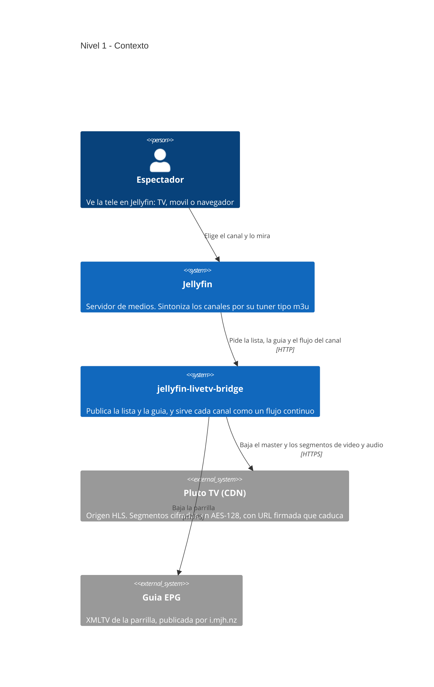
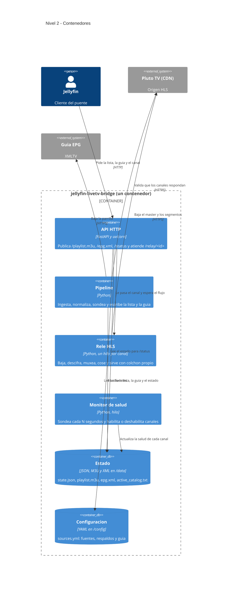
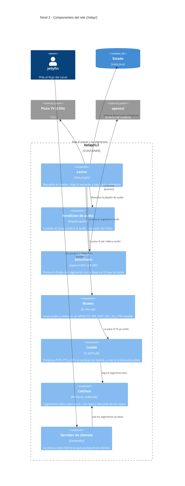
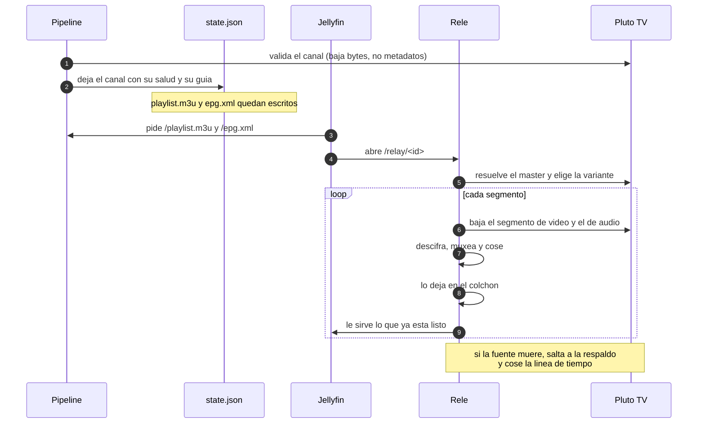

# Arquitectura

El sistema se describe con el **modelo C4**: cuatro niveles que van de lo mas
general a lo mas concreto. Cada diagrama es la vista de un nivel; el texto de
abajo dice lo que el diagrama no cabe.

El proyecto es un **puente**: toma listas HLS de terceros y las convierte en algo
que Jellyfin pueda sintonizar como si fuera un tuner de antena, con guia y todo.

```
Nivel 1   Contexto         quien lo usa y de quien depende
Nivel 2   Contenedores     las piezas que corren, dentro y fuera
Nivel 3   Componentes      por dentro del rele HLS
Nivel 4   (no aplica)      el modelo C4 lo omite: dice que se genere
                           solo si aporta, y a nivel de clase no aporta
```

---

## Nivel 1 — Contexto

Quien usa el sistema, y de que otros sistemas depende.



Lo que hay que notar:

- **Jellyfin no habla con Pluto TV.** Solo habla con el puente. Si Pluto rota
  una URL o cambia su formato, Jellyfin no se entera: el que se apaña es el
  puente.
- **La guia y el video vienen de fuentes distintas**, y se empatan por el
  `tvg-id` del canal. En Pluto ese id es el ObjectId que aparece en la URL.
- El puente **no retransmite**: reemite. Baja los bytes, los ordena y los sirve
  continuos, que es justo lo que un origen que corta a comerciales no hace.

---

## Nivel 2 — Contenedores

Las piezas que corren y el estado que comparten.



Lo que hay que notar:

- **El pipeline y el rele no comparten memoria, comparten disco.** El pipeline
  valida los canales y escribe `state.json`; el rele arranca un hilo por canal
  cuando alguien lo pide, no antes.
- **El estado vive en un bind mount** (`/data`), asi que sobrevive a recrear el
  contenedor. La configuracion tambien (`/config`).
- **El monitor de salud es independiente del pipeline**: puede deshabilitar un
  canal entre barridos, con backoff, sin esperar al siguiente.

---

## Nivel 3 — Componentes del rele

El rele es la pieza con mas partes moviles: por eso baja a este nivel y el resto
no.



Lo que hay que notar:

- **El lector y los clientes son hilos distintos, y el colchon es la frontera.**
  El lector nunca escribe directo a un cliente; los clientes nunca leen del
  origen. Esa separacion es lo que permite que un cliente entre a media emision
  sin perderse nada.
- **El descifrado y el muxeo son opcionales y se encadenan**: si el canal no
  viene cifrado, se salta el descifrado; si el audio viene en el mismo flujo, se
  salta el muxeo. Cuando el muxeo falla, se sirve el video solo y se cuenta en
  `sin_audio` en vez de tumbar el canal.
- **El cosido es lo que el proyecto vende**: al cambiar de fuente, el flujo
  sigue con la linea de tiempo continua en vez de terminar y que Jellyfin lo lea
  como fin de canal.

---

## Flujo de un canal, de punta a punta

Asi viaja un canal desde que existe una fuente hasta que se ve en una pantalla.



---

## Por que esta forma y no otra

- **Un hilo por canal, no uno por cliente.** Un canal se baja UNA vez aunque lo
  vean diez personas. Un cliente de mas cuesta ancho de banda de salida, no una
  descarga nueva.
- **Colchon en memoria, no en disco.** Los segmentos de Pluto viven segundos.
  Escribirlos a disco seria desgaste puro para un dato que se tira.
- **El pipeline y el rele separados.** Si el sondeo tarda cinco minutos, eso no
  puede bloquear a quien ya esta viendo.
- **Estado en disco y no en una base de datos.** Son unos cientos de canales con
  un puñado de campos. Una base de datos seria mas piezas que mantener que datos
  que guardar.

Lo que el sistema **no** es: no es un transcodificador, no es un grabador, y no
guarda copia de ningun contenido. Reemite lo que ya esta publicado.
